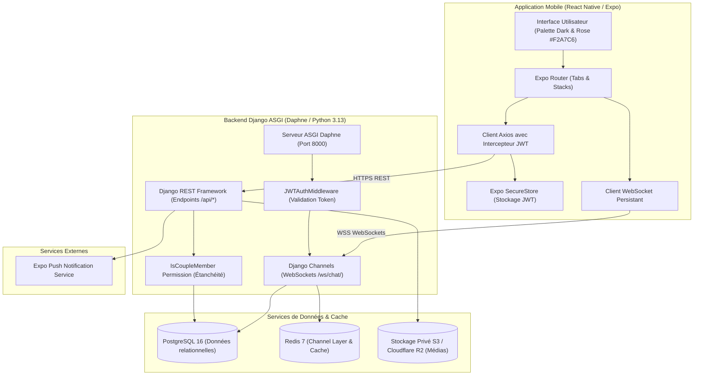

# Architecture Technique — MAN AK BAE ❤️

## 1. Vue d'ensemble du système

**Man Ak Bae ❤️** est conçu selon une architecture monolitique modulaire haute performance, garantissant une étanchéité absolue des données privées entre chaque couple tout en offrant une messagerie temps réel et des fonctionnalités riches.

## 2. Structure Modulaire du Backend Django

Le backend est découpé en 9 applications hautement découplées :

1. **`apps.accounts`** : Gestion des utilisateurs (`User` personnalisé), profils, avatars, hachage argon2/bcrypt des mots de passe, sessions JWT (SimpleJWT avec rotation et blacklist).
2. **`apps.couples`** : Création d'espaces de couple, génération de codes secrets cryptographiquement sûrs (8 caractères sans ambiguïté), règle absolue des **2 membres maximum**, calcul de la durée de la relation, tableau de bord d'accueil (`HomeDashboardView`).
3. **`apps.messaging`** : Messagerie temps réel via Django Channels (`ChatConsumer`), messages texte, vocaux, photos, accusés de lecture ("sent", "delivered", "read"), réactions emojis instantanées (❤️, 🔥, etc.), notifications de frappe ("en train d'écrire...").
4. **`apps.flames`** : Système de streak quotidien selon le fuseau horaire de référence **`Africa/Dakar`**. Calcul automatique dès qu'un message admissible est posté ; incrémentation uniquement lorsque les 2 partenaires ont participé dans la même journée.
5. **`apps.games`** : 7 jeux de couple interactifs (*Action ou vérité*, *Tu préfères quoi ?*, *Quiz de couple*, *Qui connaît mieux l'autre ?*, *Questions profondes*, *Défis romantiques*, *Devine ma réponse*), tirage aléatoire, synchronisation des votes et comparaison de réponses.
6. **`apps.memories`** : Albums photos et vidéos privés, galerie avec dates et lieux, commentaires intimes entre partenaires.
7. **`apps.calendar_app`** : Agenda partagé du couple avec dates importantes, anniversaires, dîners aux chandelles et alertes de rappels.
8. **`apps.surprises`** : Boîte aux lettres d'amour programmées (déverrouillage temporel sécurisé : contenu invisible tant que la date n'est pas échue) et surprises avec indices.
9. **`apps.notifications_app`** : Enregistrement des tokens push Expo (Android & iOS), routage des notifications in-app et alertes en arrière-plan.

## 3. Architecture Mobile React Native / Expo

L'application mobile repose sur les standards les plus récents :
- **Expo Router 4.0** : Routage basé sur les fichiers avec gestion des segments protégés (`(auth)` vs `(tabs)`).
- **React Native Reanimated 3** : Animations fluides pour les cœurs battants, flammes et transitions.
- **Expo SecureStore** : Stockage chiffré matériel des jetons d'accès et de rafraîchissement JWT.
- **Expo ImagePicker & AV** : Capture multimédia et messages vocaux.

