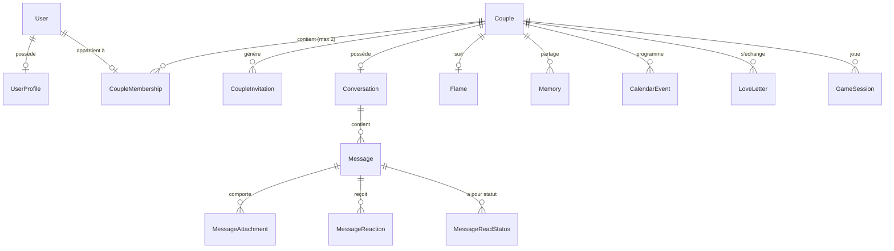

# Structure de la Base de Données — PostgreSQL

La base de données principale est **PostgreSQL 16+**. Elle est modélisée avec des clés primaires UUID pour éviter toute énumération d'identifiants, des contraintes d'unicité strictes et des index optimisés.

## Schéma Relationnel

## Description des Tables Clés

### 1. `accounts_user` & `accounts_userprofile`
- `id` (int/BigAuto): Identifiant utilisateur.
- `email` (varchar, Unique, Indexé): Identifiant de connexion principal.
- `username` (varchar, Unique).
- `password` (varchar): Hash sécurisé PBKDF2 / Argon2.
- `nickname` (varchar): Surnom romantique affiché.
- `avatar` (varchar): Chemin ou URL S3 de l'avatar.
- `is_online` (bool): Statut de présence temps réel.
- `last_seen` (timestamp with time zone).

### 2. `couples_couple` & `couples_couplemembership`
- `id` (UUID, PK): Identifiant non prédictible du couple.
- `name` (varchar): Nom du couple (ex: "Man Ak Bae ❤️").
- `relationship_start_date` (date): Date de début de relation utilisée pour le calcul du temps ensemble.
- `is_active` (bool): Statut d'activité.
- **Contrainte `UniqueConstraint(couple, user)`** : Un utilisateur ne peut avoir qu'un seul membership actif.
- **Règle applicative stricte** : Au niveau service et contrôleur, `memberships.count() < 2` est vérifié sous transaction `select_for_update()`.

### 3. `couples_coupleinvitation`
- `id` (BigAuto, PK).
- `code` (varchar 12, Unique, Indexé) : Code d'invitation à 8 caractères alphanumériques non ambigus généré par `secrets.choice()`.
- `expires_at` (timestamp with time zone) : Expiration automatique à 48 heures.
- `is_used` (bool).

### 4. `messaging_conversation` & `messaging_message`
- `id` (UUID, PK).
- `conversation_id` (UUID, FK).
- `sender_id` (FK User).
- `message_type` (varchar: 'text', 'image', 'video', 'audio', 'heart').
- `content` (text).
- `reply_to_id` (UUID, FK nullable).
- `created_at` (timestamp, Indexé).
- `deleted_for_all` (bool).

### 5. `flames_flame` & `flames_flameactivity`
- `current_streak` (integer): Série de jours consécutifs en cours.
- `longest_streak` (integer): Record historique de flammes.
- `last_streak_date` (date): Dernière date validée (fuseau Africa/Dakar).
- `FlameActivity` possède une contrainte d'unicité `(flame, user, activity_date)`.

### 6. `surprises_loveletter`
- `id` (UUID, PK).
- `unlock_at` (timestamp with time zone): Date future de déverrouillage.
- **Sécurité** : Si `now < unlock_at`, la méthode `to_representation` masque le contenu pour le destinataire.

### 7. `calendar_app_calendarevent`
- `start_time` (timestamp with time zone, Indexé).
- `category` ('date_night', 'restaurant', 'cinema', 'anniversary', 'trip', 'activity').

